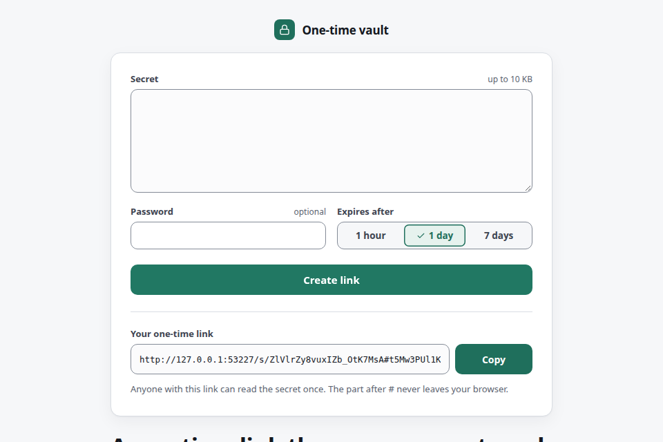
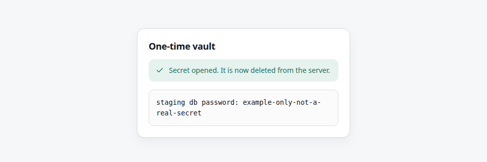
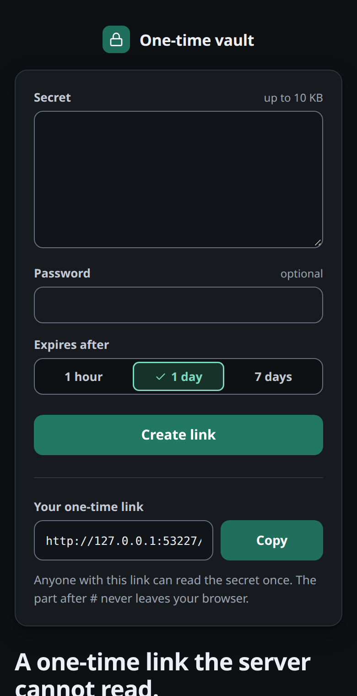

# one-time-vault

[](https://github.com/katincko/one-time-vault/actions/workflows/ci.yml)
[](LICENSE)

Share a secret through an encrypted link that opens only once. A small web app you host yourself.

- **The server cannot read it.** Your browser encrypts the text before it is sent; the server
  only keeps encrypted data.
- **It opens once.** The first read deletes the secret.
- **Link previews do not spend it.** Slack, WhatsApp and other chat apps open links on their own to
  build a preview. Here the secret only comes out after a click on "Reveal".
- **Optional password.** Five wrong tries delete the secret.

Use it to send a password, an API key or a recovery code by chat or e-mail without leaving it in
the history for good.

[Run it](#run-it) | [How it works](#how-it-works) | [Security](#security-at-a-glance) | [Tests](#tests)

**Try it live: [vault.siriusoftware.com.br](https://vault.siriusoftware.com.br)** (a public demo:
do not paste a real secret there, host your own for that)

| Create the link | Open and reveal | Dark theme, phone |
|---|---|---|
|  |  |  |

## Run it

Prerequisites: [uv](https://docs.astral.sh/uv/), Docker, Node 24 and Python 3.12 (uv installs
it). The Python in the commands is always `uv run python`, because Ubuntu and Debian have no
`python`.

```
git clone https://github.com/katincko/one-time-vault.git
cd one-time-vault
export OTV_SERVER_KEYS="1:$(uv run python -c 'import secrets; print(secrets.token_urlsafe(32))')"
docker compose up --build
```

Open http://127.0.0.1:8000. To stop it and drop the data, in any shell:

```
OTV_SERVER_KEYS=unused docker compose down -v
```

(`compose.yaml` demands the variable even for `down`, so the command carries a value.)

Without Docker for the app, run a Redis or Valkey on `localhost:6379` and:

```
uv sync --locked
export OTV_SERVER_KEYS="1:$(uv run python -c 'import secrets; print(secrets.token_urlsafe(32))')"
uv run uvicorn --factory --no-proxy-headers --no-server-header one_time_vault.app:app_from_env
```

`--no-proxy-headers`: the app has its own client IP logic (`OTV_TRUSTED_HOPS`).
`--no-server-header`: the answers do not name the server software. The access log masks the
secret id. Settings are listed in [docs/security.md](docs/security.md#configuration).

## How it works

```
creator's browser                         server (FastAPI + Redis or Valkey)
  256-bit key; HKDF-SHA256 makes two      stores {iv + ciphertext, optional keyed hash of the
  subkeys ("encryption", "password")      password verifier} under a server-made 128-bit id,
  AES-256-GCM over the padded text  --->  with a lifetime of 1 hour, 1 day or 7 days
  link = /s/<id>#<key>                    never sees what comes after the #

recipient's browser
  GET /s/<id>      ------------------->   the same page for every id; storage is not touched,
                                          so previews and crawlers consume nothing
  click "Reveal"   -- POST ----------->   one Lua step checks, delivers and deletes
  decrypts, removes the # from the address bar
```

Decisions that shape it:

- **Reveal needs a click.** A `GET` cannot be the read, or any link preview would spend the link.
- **One atomic Lua step** delivers and deletes, so two readers never both get the secret.
- **The password is access control, not encryption.** Five wrong tries delete the secret.
- **The server checks 256-byte blocks**, so it never learns the exact text length.
- **Server keys have versions**, so a key can rotate without losing stored secrets.

The reasons and the costs of each are in [docs/security.md](docs/security.md#decisions-and-trade-offs).

| Part | Choice |
|---|---|
| Server | Python 3.12, FastAPI, pydantic in strict mode |
| Storage | Redis or Valkey, one hash per secret, the key TTL is the expiry |
| Browser | Plain ES modules, JSDoc types checked by `tsc`, no build step |
| Cryptography | WebCrypto: HKDF-SHA256, AES-256-GCM, PBKDF2-SHA256 |
| Tests | pytest, real Redis and Valkey containers, Playwright with Chromium |
| Tooling | uv, ruff, mypy (strict), Docker Compose, GitHub Actions, gitleaks |

## Security at a glance

Every row is a test, not a claim. The full table, with the name of each test, the threat model and
the findings fixed, is in [docs/security.md](docs/security.md).

| Guarantee | How it is checked |
|---|---|
| The server never sees the text or the key | Two canaries searched in every request, the log and every Redis key |
| At most one reader | 50 simultaneous readers, in one process and across processes, on Redis and Valkey |
| Previews do not burn the link | `GET` and `HEAD` consume nothing, tested with preview agents and a browser |
| A dead id looks like a missing one | One 404, byte for byte |
| Altered ciphertext is refused | AES-GCM in the browser |
| Security headers on every response the app makes | A CSP with a fresh nonce, HSTS, `nosniff`, `no-store`, on 2xx, 4xx and 500 |
| Creation is rate limited | Per client IP, atomic, a forged `X-Forwarded-For` does not pick the bucket |

What it does not protect against: a server that serves altered JavaScript, a link pasted where
others can read it, a malicious browser extension, and a bot that clicks "Reveal" first. The
[threat model](docs/security.md#threat-model) lists all of them.

To report a vulnerability, see [SECURITY.md](SECURITY.md).

## Tests

```
git clone https://github.com/katincko/one-time-vault.git
cd one-time-vault
uv sync --locked
npm ci
uv run playwright install chromium
uv run pytest tests/test_access_log.py tests/test_api.py tests/test_browser.py \
  tests/test_browser_crypto.py tests/test_browser_design.py tests/test_browser_iterations.py \
  tests/test_browser_password.py tests/test_canary_finder.py tests/test_dash_check.py \
  tests/test_gates.py tests/test_headers.py tests/test_keyring.py tests/test_limits.py \
  tests/test_password.py tests/test_race.py tests/test_race_processes.py tests/test_readme.py \
  tests/test_request_shape.py tests/test_storage.py tests/test_storage_hardening.py -q
```

That is one sequence from the clone to `passed`. The last line reads `524 passed`, after about 2 minutes on a laptop (the Docker image pulls and
the Chromium download come before). Docker must be running: the tests start real `redis:7.4` and
`valkey/valkey:8.0` containers.

The count is **524 test cases**. Many tests run twice, once on Redis and once on Valkey, so one
test function can count as two cases. An older version of this project had 138 tests, and
[docs/negative-proofs.md](docs/negative-proofs.md) still quotes that number for its lot. A test
fails when the count in this README is not the real one.

The whole gate, which CI also runs:

```
make verify
```

It runs ruff, ruff format, mypy, `tsc`, the suite, a dependency audit, gitleaks and a dash check.
Without `make`, run the steps of the `Makefile` one by one.

CI also runs the real `compose.yaml` in a job of its own: `scripts/compose_smoke.py` builds and
starts it, waits for the healthchecks, creates a secret through the API, reads it once, checks
that the second read is a 404, and takes it all down. To run it locally (Docker running, port
8000 free):

```
uv run --no-project python scripts/compose_smoke.py
```

The pictures at the top come from the real app: `uv run python scripts/screenshots.py` makes them
again.

## Good practices

- **Negative proofs.** Each guarding test was run with the bug planted, shown red for the right
  reason, and restored. See [docs/negative-proofs.md](docs/negative-proofs.md).
- **Real services.** No fake Redis: real containers and a real uvicorn process.
- **Harnesses that check themselves.** The race harness must report violations on a naive storage.
- **One gate, pinned inputs.** Actions pinned by commit SHA, images by digest, `uv sync --locked`.
- **The README is tested.** Its commands, its test count and its links have tests.

## Credits and license

The access password follows the design of Bitwarden Send. MIT license, see [LICENSE](LICENSE).
